<!-- GENERATED FILE: edit data/profile.json and config/theme.json, then run npm run build. -->
<p align="center">
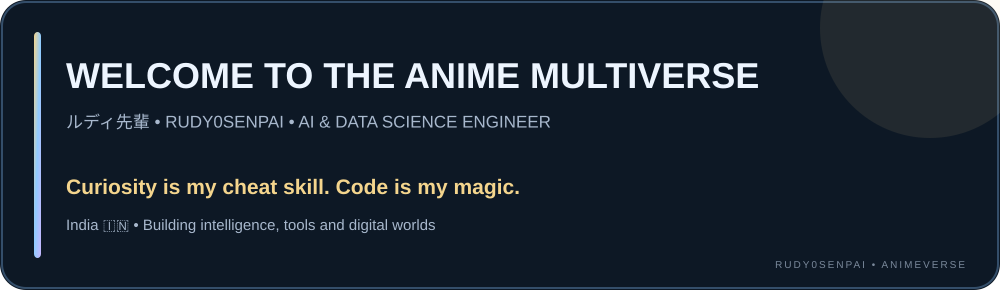
</p>
<p align="center">

</p>
<p align="center">
<b>Dhruv Pratap Chaubey</b> · <a href="https://github.com/rudy0senpai">@rudy0senpai</a>
</p>
<p align="center">
<code>Welcome to my Anime Multiverse!</code> &nbsp; <code>The Pirate King of Programming!</code> &nbsp; <code>Dattebayo! I will master AI!</code> &nbsp; <code>10 Billion Percent Brainpower!</code> &nbsp; <code>Gotta Code 'Em All!</code> &nbsp; <code>My magic is programming!</code>
</p>
<p align="center">
   
</p>
<p align="center">
<a href="https://github.com/rudy0senpai">GitHub</a> · <a href="https://www.linkedin.com/in/dhruv-pratap-chaubey-09212b380/">LinkedIn</a>
</p>
<p align="center">
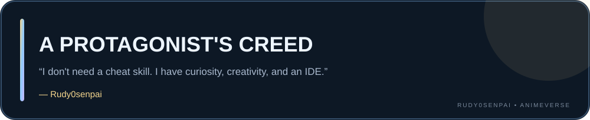
</p>

## 🧬 Character dossier

<details open><summary><b>Protagonist profile</b></summary>

```javascript
const protagonist = {
  name: "Dhruv Pratap Chaubey",
  alias: "Rudy0senpai",
  class: "AI & Data Science Engineer",
  origin: "India 🇮🇳",
  abilities: [
    "Python Manipulation",
    "Data Analysis",
    "Problem Solving",
    "World Building",
    "Creative Thinking"
  ],
  currentArc: "The Journey to Becoming Legendary",
  dream: "Build worlds, create intelligence, change reality."
};
```
</details>

## 🏴‍☠️ The Grand Line — Tech inventory

<p align="center">
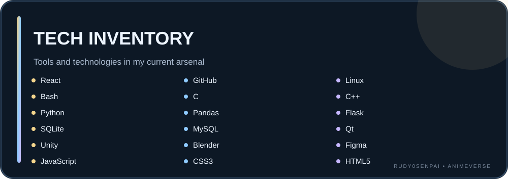
</p>

<table><tr><td align="center"><code>React</code></td><td align="center"><code>GitHub</code></td><td align="center"><code>Linux</code></td><td align="center"><code>Bash</code></td><td align="center"><code>C</code></td><td align="center"><code>C++</code></td></tr><tr><td align="center"><code>Python</code></td><td align="center"><code>Pandas</code></td><td align="center"><code>Flask</code></td><td align="center"><code>SQLite</code></td><td align="center"><code>MySQL</code></td><td align="center"><code>Qt</code></td></tr><tr><td align="center"><code>Unity</code></td><td align="center"><code>Blender</code></td><td align="center"><code>Figma</code></td><td align="center"><code>JavaScript</code></td><td align="center"><code>CSS3</code></td><td align="center"><code>HTML5</code></td></tr></table>

## 🧪 Dr. Stone's laboratory — Skills in training

| Field | Technologies |
|:--|:--|
| 🧠 AI & ML | Machine Learning, Deep Learning, Generative AI |
| 📊 Data Science | Python, Pandas, NumPy, SQL |
| 📈 Analytics | Excel, Power BI, Tableau |
| 🌐 Web Development | HTML, CSS, JavaScript, React |
| ⚙️ Backend | Flask, SQLite |
| 🎮 Game Development | Unity, C#, Blender |
| 🐧 Linux Engineering | Arch-based distributions customization |
| 🤖 AI Experiments | LLMs, local inference, AI agents |

## 🌍 Multiverse saga — Project quests

*Every world has a story. Every project has a purpose.*

<p align="center">
</p>
A library management system bringing users, departments, and librarians together in one organized ecosystem.

**Special abilities:** Authentication, book management, departmental organization.

`Flask` · `SQLite` · `JavaScript`

[Open repository ↗](https://github.com/rudy0senpai/LibSpace)

---

<p align="center">
</p>
A dedicated anime collection manager for organizing and exploring your anime universe.

**Special abilities:** Anime metadata, posters, collection management.

`Python` · `PySide6` · `APIs`

[Open repository ↗](https://github.com/rudy0senpai/AniListVault)

---

<p align="center">
</p>
Turning raw sales data into powerful business intelligence and actionable insights.

**Special abilities:** Data cleaning, visualization, KPI analysis.

`Power BI` · `Excel` · `Data Analytics`

[Open repository ↗](https://github.com/rudy0senpai?tab=repositories)

---

<p align="center">
</p>
An anime-inspired chaotic open-world game with procedural environments, exploration, and immersive gameplay.

**Special abilities:** Procedural terrain, world building, game mechanics.

`Unity` · `C#` · `Blender`

[Open repository ↗](https://github.com/rudy0senpai)

---

<p align="center">
</p>
A Linux customization project merging sleek desktop aesthetics with anime-inspired visual identity.

**Special abilities:** Custom branding, desktop theming, system customization.

`Linux` · `Shell` · `System Customization`

## ⚔️ Anime universes I call home

<details><summary>🏴‍☠️ <b>One Piece — The Dream of the Pirate King</b></summary>

My ambition has no limits. The journey is more important than the destination.

*“I'm gonna become the King of Developers!”*

</details>

<details><summary>🍥 <b>Naruto — The Never-Give-Up Ninja Way</b></summary>

Training, perseverance, overcoming failure, and proving that hard work can surpass talent.

*“Believe it! Dattebayo!”*

</details>

<details><summary>⏳ <b>Re:Zero — The Debugging Loop</b></summary>

Every failed build is another timeline. Every error is an opportunity to return stronger.

*“git commit → git push → git regret → git fix → Repeat.”*

</details>

<details><summary>🧪 <b>Dr. Stone — 10 Billion Percent Scientific Genius</b></summary>

Rebuilding civilization, one experiment and one algorithm at a time.

</details>

<details><summary>📓 <b>Death Note — The Bug Elimination Protocol</b></summary>

Target: NullPointerException. Cause: missing initialization. Time of death: 11:59 PM, right before the deadline.

</details>

<details><summary>🎯 <b>Hunter × Hunter — The Nen Training Arc</b></summary>

Nen type: Specialization. Ability: turning random ideas into actual projects. Limitation: insufficient sleep and occasional procrastination.

</details>

<details><summary>🔥 <b>Fairy Tail — The Power of Friendship &amp; Collaboration</b></summary>

Great projects are built through teamwork, shared knowledge, and mutual support.

</details>

<details><summary>🗡️ <b>Attack on Titan — The War Against Bugs</b></summary>

The bugs are inside the codebase. Humanity's survival depends on the next deployment.

*“Tatakai!”*

</details>

<details><summary>🥋 <b>Baki — The Ultimate Coding Workout</b></summary>

No shortcuts. Just discipline, practice, and progressively harder challenges.

</details>

<details><summary>👽 <b>Dan Da Dan — The Paranormal Debugging Division</b></summary>

Sometimes the bug is so bizarre that even Stack Overflow cannot explain it. Aliens? Ghosts? Undefined behavior? We investigate.

</details>

<details><summary>🌑 <b>The Eminence in Shadow — Operation: Background Developer</b></summary>

I don't just write code. I orchestrate entire systems from the shadows.

*“I am atomic... in software engineering.”*

</details>

<details><summary>✂️ <b>Scissor Seven — The Assassin of Broken Code</b></summary>

Looks like a beginner. Codes like a professional assassin. Debugging contract accepted.

</details>

<details><summary>🌸 <b>TONIKAWA — The Wholesome Side of the Multiverse</b></summary>

Even the strongest protagonist needs a peaceful slice-of-life episode. Anime, creativity, and happiness: the ultimate balance.

</details>

<details><summary>🍀 <b>Black Clover — No Magic, Just Determination</b></summary>

I may not have unlimited talent, but I have unlimited determination.

*“My grimoire contains Python.”*

</details>

<details><summary>🐉 <b>Dragon Ball — Power Level: Over 9000!</b></summary>

Every new project is another training session.

*“Super Saiyan Developer → Ultra Instinct Debugging.”*

</details>

## ⚡ Pokémon — Developer party

<p align="center"><i>Each Pokémon represents a different ability in my arsenal.</i></p>
<table align="center"><tr><td align="center"><br/><b>Pikachu ⚡</b><br/>JavaScript</td><td align="center"><br/><b>Alakazam 🧠</b><br/>Artificial Intelligence</td><td align="center"><br/><b>Porygon 💻</b><br/>Software Development</td></tr><tr><td align="center"><br/><b>Magnemite ⚙️</b><br/>Hardware & Systems</td><td align="center"><br/><b>Ditto 🔄</b><br/>Adaptability</td><td align="center"><br/><b>Eevee ✨</b><br/>Evolution & Growth</td></tr></table>
<p align="center"><b>Gotta catch bugs… I mean, Pokémon!</b></p>

## 🎭 Isekai Quartet — The chaotic crossover

<p align="center"><i>When protagonists from different worlds get summoned into one classroom, chaos is inevitable.</i></p>
<table align="center"><tr><td align="center"><br/><b>🗡️ Kazuma</b><br/>Resourcefulness</td><td align="center"><br/><b>💧 Aqua</b><br/>Divine Powers</td><td align="center">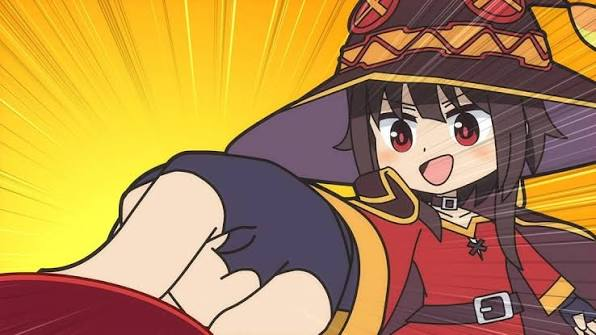<br/><b>💥 Megumin</b><br/>EXPLOSION!</td></tr><tr><td align="center"><br/><b>💀 Ainz</b><br/>Supreme Intelligence</td><td align="center"><br/><b>🖤 Albedo</b><br/>Absolute Loyalty</td><td align="center">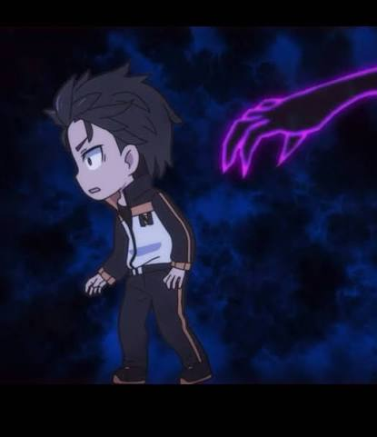<br/><b>⏳ Subaru</b><br/>Return by Death</td></tr><tr><td align="center"><br/><b>❄️ Emilia</b><br/>Ice Magic</td><td align="center">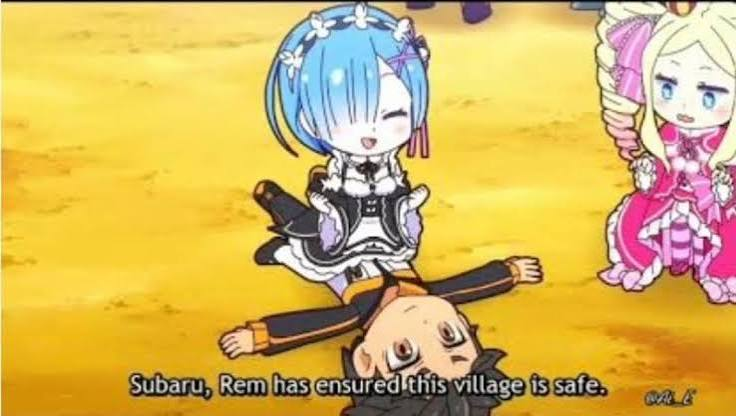<br/><b>💙 Rem</b><br/>Combat & Support</td><td align="center"><br/><b>✈️ Tanya</b><br/>Military Strategy</td></tr></table>

### Classroom survival guide

| Situation | Expected outcome |
|:--|:--|
| Megumin casts Explosion | Classroom destroyed |
| Aqua attempts to help | Situation gets worse |
| Ainz starts calculating | Everyone gets nervous |
| Tanya makes a strategic plan | War is declared |
| Subaru tries to explain | Nobody believes him |
| Kazuma encounters trouble | STEAL! |

<details><summary>More classroom chaos</summary>

<p align="center"></p>

**「 This classroom is more dangerous than any final boss. 」**

</details>

## 🌪️ That Time I Got Reincarnated as a Slime — Great Sage

<p align="center"></p>

> “Analysis complete. The optimal solution has been determined.”

| AI entity | Unique ability |
|:--|:--|
| 🤖 Claude | Deep reasoning, creative thinking & complex problem solving |
| ⚔️ OpenAI Codex | Code generation, software engineering & debugging |
| 🐺 Hermes Agent | Autonomous tasks, agent workflows & tool execution |
| 🎨 ComfyUI | AI image generation & visual creativity |
| 🔮 Bionic | AI workflow orchestration & MCP integrations |
| 🦙 Ollama | Local LLM deployment & private AI inference |
| 🖥️ OpenCode | AI-powered coding directly in the terminal |

<details><summary>✨ Evolution: Great Sage → Raphael</summary>

```text
       GREAT SAGE
           │
           ▼
 Artificial Intelligence
           │
           ▼
       R A P H A E L
           │
           ▼
 Lord of Developer Skills
```

*The goal: build an intelligent AI companion capable of understanding, creating, and evolving alongside me.*

</details>

## 🧋 The Apothecary Diaries — Investigation division

<p align="center"><i>Poison, medicine, mysteries, and one extremely curious apothecary.</i></p>
<table align="center"><tr><td align="center">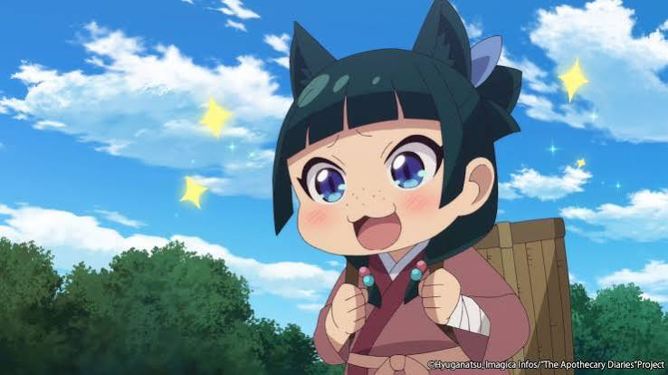<br/><b>🧪 Maomao</b><br/>Root Cause Analysis</td><td align="center">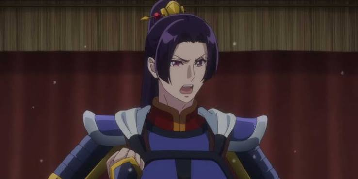<br/><b>🌸 Jinshi</b><br/>Management & Coordination</td><td align="center">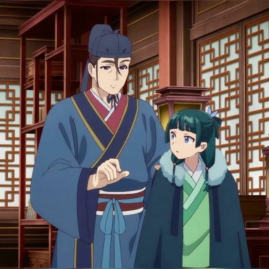<br/><b>🛡️ Gaoshun</b><br/>Monitoring & Protection</td><td align="center">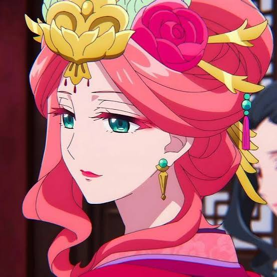<br/><b>🍃 Gyokuyou</b><br/>Diplomacy & Social Intelligence</td><td align="center"><br/><b>🔬 Luomen</b><br/>Medical Knowledge & Mentorship</td></tr></table>

### Maomao's investigation protocol

```text
01  Examine the evidence
02  Identify unusual patterns
03  Test the hypothesis
04  Analyze the substance
05  Reveal the truth
```

```python
def investigate_bug(error):
    evidence = collect_logs(error)
    hypothesis = analyze(evidence)
    if hypothesis.is_confirmed():
        return resolve_issue(hypothesis)
    return "Interesting... further investigation required."
```

*Every bug is a mystery. Every error log is evidence.*

## 📊 Power level — GitHub statistics

<table><tr><td></td><td></td></tr><tr><td></td><td></td></tr><tr><td colspan="2"></td></tr></table>

## 🐍 The contribution dragon

<p align="center">
<picture><source srcset="./assets/generated/contribution-snake.gif" type="image/gif"/>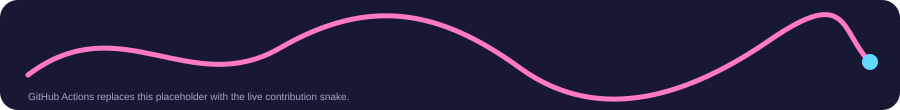</picture>
</p>

## 😂 Anime developer memes

<p align="center">

</p>

**Me:** I'll just fix one tiny bug before sleeping.

**Also me, 4 hours later:**

```text
The bug was not the problem. The bug was the friends we made along the way.
```

<details><summary>💀 My developer life in five stages</summary>

1. 😎 “This should be easy.”
2. 🤓 “I understand the documentation.”
3. 🤔 “Why is it not working?”
4. 🤡 “Who wrote this code?”
5. 🗿 “Oh... it was me.”

</details>

## 🎵 Current arc soundtrack

<p align="center">
 
</p>
**Current mood:** Somewhere between an epic shonen training arc and a Re:Zero mental breakdown.

## 🌐 The guild — Connect with me

<p align="center">
<a href="https://github.com/rudy0senpai"></a> &nbsp; <a href="https://www.linkedin.com/in/dhruv-pratap-chaubey-09212b380/"></a>
</p>
<p align="center">
Collaborations · Open Source · AI · Game Development · Anime Discussions
</p>
<p align="center">
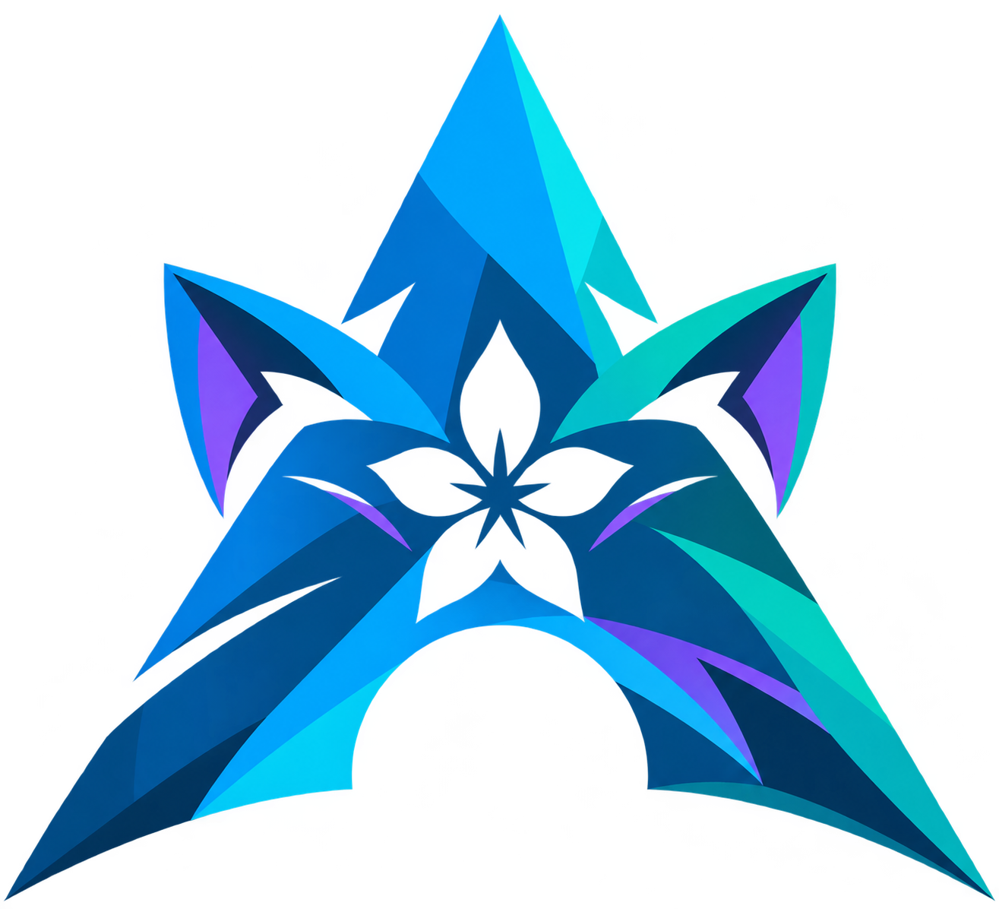
</p>
<p align="center">
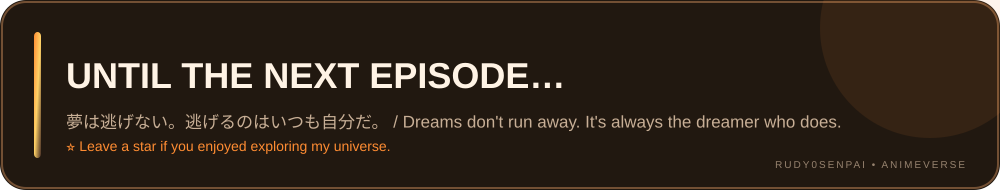
</p>
<p align="center">
<b>Dreams don't run away. It's always the dreamer who does.</b>
</p>
<p align="center">
<i>Until our next adventure... See you in the next episode! ✨</i>
</p>

---

<sub>Theme: **AnimeVerse** · Generated locally by [AnimeVerse Theme Engine](./docs/THEMING.md).</sub>
